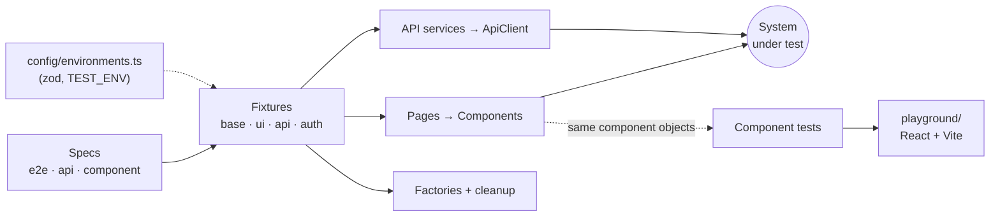

# Playwright AI-Powered

**An AI-ready Playwright + TypeScript template for Web UI, API and Component testing.** Strict architecture, guardrails that agents can't talk their way around, and CI/reporting wired from day one.

[](https://github.com/aroygas/playwright-ai-powered/actions/workflows/pr.yml)
[](https://github.com/aroygas/playwright-ai-powered/actions/workflows/nightly.yml)
[](https://aroygas.github.io/playwright-ai-powered/)


[](LICENSE)

> Demo targets: [saucedemo.com](https://www.saucedemo.com) (web) and [restful-booker](https://restful-booker.herokuapp.com) (API). Swap them for your own with one command, see [Use as a template](#use-as-a-template).

## Highlights

|                          |                                                                                                           |
| ------------------------ | --------------------------------------------------------------------------------------------------------- |
| 🧱 **Three test layers** | E2E (Chromium, Firefox, WebKit, mobile), API (no browser) and React component tests on one shared toolbox |
| 🧩 **Component Object Model** | Pages compose components; locators only via `getByRole` > `getByLabel` > `getByTestId`, enforced by lint |
| 🔐 **Auth once per role** | `test.use({ role: 'admin' })`: cached `storageState` + API token, no login steps in specs                |
| 🧪 **Typed API layer**   | `ApiClient` + thin services + zod contract checks + faker factories with auto-cleanup                     |
| 🤖 **Built for agents**  | One `AGENTS.md`, glob-scoped rules, prompts, MCP servers, planner/generator/healer agents, `npm run ai:check` |
| 🚦 **Quality gates**     | Flaky gate on changed specs, quarantine policy, Docker-rendered visual baselines                          |
| 📊 **CI + Allure**       | Sharded GitHub Actions, reduced GitLab variant, Allure with history published to GitHub Pages                      |

## Architecture



Specs only call objects and assert. Objects only locate and act. Services only return responses. Details and the full map: [`AGENTS.md`](AGENTS.md).

## Quick start

```bash
git clone https://github.com/aroygas/playwright-ai-powered.git
cd playwright-ai-powered
npm ci
npm run browsers:install   # all browsers (playwright install --with-deps)
npm run test:smoke         # @smoke on every browser project + API
npm run test:ct         # component tests
```

Requires Node ≥ 22.22.1 and npm ≥ 10.9 (`.nvmrc` pins 24, the version CI uses for tests). If a run fails with "Executable doesn't exist", a browser is missing: run `npm run browsers:install` (on Linux it may need `sudo`). Credentials for the demo sites are public and committed in `config/env/*.env`; override anything via process env or a gitignored `.env` (see `.env.example`). The `github` MCP server in `.mcp.json` needs a read-only `GITHUB_MCP_TOKEN` in your environment, otherwise it fails to connect (see [`docs/MCP.md`](docs/MCP.md)).

## Commands

| Command                                              | What                                                      |
| ---------------------------------------------------- | --------------------------------------------------------- |
| `npm run browsers:install`                           | Install all Playwright browsers and system deps           |
| `npm run ai:check`                                   | Lint + typecheck + list + smoke: the gate before any change |
| `npm test` / `test:smoke` / `test:api` / `test:e2e`  | Everything / smoke / API only / all browsers              |
| `npm run test:ct`                                    | Component tests                                           |
| `npm run test:env:<local\|dev\|staging\|prod>`       | Pick the target environment                               |
| `npm run test:flaky`                                 | Re-run changed specs ×5 without retries                   |
| `npm run test:ct:update`                             | Regenerate visual baselines in Docker                     |
| `npm run docker:test`                                | Run in the pinned Playwright image                        |
| `npm run report:allure` / `report:allure:open`       | Build / open the Allure report                            |
| `npm run playground:dev`                             | Explore the component playground                          |

## Project layout

```
config/       typed env (zod) + per-environment defaults
src/          api/ (client, services, schemas) · ui/ (components, pages) · fixtures/ · auth/ · data/ · utils/
tests/        e2e/ · api/ · component/ · setup/ · seed.spec.ts
playground/   React + Vite app mounted by component tests
specs/        Markdown test plans (planner agent)
.ai/          prompts and code templates for agents
docs/         CI · MCP · QUALITY · DESIGN
```

## AI-ready by design

- **One source of truth:** [`AGENTS.md`](AGENTS.md) holds the architecture map, golden rules and Definition of Done; Claude, Cursor, Windsurf, Cline and Copilot rules are thin pointers to it.
- **Guardrails over guidelines:** ESLint bans sleeps, raw locators and unjustified `eslint-disable`; the closed tag vocabulary lives in `src/utils/tags.ts`.
- **Live grounding:** MCP servers for browser exploration, test running and the repo ([`docs/MCP.md`](docs/MCP.md)).
- **Agent loop:** planner → `specs/*.md` → generator → `tests/**` → healer, all seeded by `tests/seed.spec.ts`.
- **Self-check:** `npm run ai:check` runs the same gate for agents locally and for CI.

## CI & reports

PRs run lint/typecheck, component, API, a sharded E2E smoke and the flaky gate. The nightly regression covers all browsers and publishes an [Allure report](https://aroygas.github.io/playwright-ai-powered/) with history to GitHub Pages. Details: [`docs/CI.md`](docs/CI.md), policies: [`docs/QUALITY.md`](docs/QUALITY.md).

## Use as a template

Click **Use this template** on GitHub (or clone), then:

```bash
npm run init:project -- --name acme-e2e --base-url https://staging.acme.com --api-url https://api.staging.acme.com --repo acme/acme-e2e --author "Acme Inc"
```

This renames the package and reports, points every environment at your URLs, resets the demo credentials to placeholders and prints the remaining manual steps (swap the demo pages/services/specs, roles, CI secrets). Add `--dry-run` to preview.

## Contributing

See [`CONTRIBUTING.md`](CONTRIBUTING.md) (PRs use a short checklist; vulnerabilities go through [`SECURITY.md`](SECURITY.md)). Design decisions: [`docs/DESIGN.md`](docs/DESIGN.md).

## License

[MIT](LICENSE)
